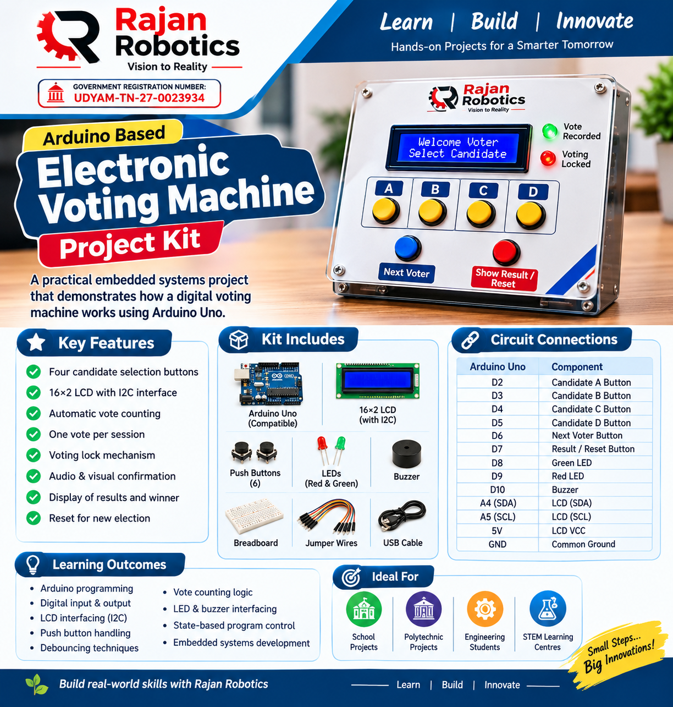

🗳️ Arduino Based Electronic Voting Machine

Rajan Robotics | Learn • Build • Innovate

An Arduino Uno-based Electronic Voting Machine designed as a practical embedded systems project. This project demonstrates how to build a digital voting system using push buttons, an LCD display, LEDs and a buzzer.

"Rajan Robotics Electronic Voting Machine" (images/RR_Electronic_Voting_Machine_Brochure.png)

📌 Project Overview

The Electronic Voting Machine allows users to cast votes for four different candidates using individual push buttons.

The system automatically counts votes, prevents multiple votes during a single voting session, provides audio and visual confirmation, and displays the final election results on a 16×2 LCD.

This project is designed for students, electronics enthusiasts, and beginners interested in Arduino programming and embedded systems.

✨ Key Features

- Four candidate selection buttons (A, B, C and D).
- 16×2 LCD with I2C interface.
- Automatic vote counting.
- One vote per voting session.
- Voting lock mechanism.
- Audio confirmation using a buzzer.
- Visual confirmation using LEDs.
- Administrator-controlled next voter option.
- Display of individual candidate vote counts.
- Automatic winner and tie detection.
- Reset functionality for a new election.

🔧 Components Required

Component| Quantity
Arduino Uno| 1
16×2 LCD with I2C module| 1
Push Buttons| 6
Red LED| 1
Green LED| 1
220Ω Resistors| 2
Active Buzzer| 1
Breadboard| 1
Jumper Wires| As required
USB Cable| 1

🔌 Circuit Connections

Arduino Uno Pin Configuration

Arduino Pin| Component
D2| Candidate A Button
D3| Candidate B Button
D4| Candidate C Button
D5| Candidate D Button
D6| Next Voter Button
D7| Result / Reset Button
D8| Green LED
D9| Red LED
D10| Buzzer
A4| LCD SDA
A5| LCD SCL
5V| LCD VCC
GND| Common Ground

Push Button Connections

Each push button is connected between its assigned Arduino digital pin and GND.

The Arduino internal pull-up resistors are enabled using "INPUT_PULLUP".

LED Connections

- Green LED anode → D8 through 220Ω resistor.
- Red LED anode → D9 through 220Ω resistor.
- Both LED cathodes → GND.

Buzzer Connections

- Buzzer positive → D10.
- Buzzer negative → GND.

Check the buzzer current rating. Use a transistor driver if necessary.

LCD I2C Connections

LCD Pin| Arduino Uno
VCC| 5V
GND| GND
SDA| A4
SCL| A5

⚙️ Working Principle

1. The LCD displays the welcome message.
2. The voter selects one candidate using the corresponding push button.
3. The Arduino registers the vote and increments the candidate's vote count.
4. The green LED and buzzer indicate successful voting.
5. The voting system enters the locked state.
6. The administrator presses the Next Voter button to enable the next voting session.
7. The administrator presses the Result button to display voting statistics.
8. The system identifies the winner or announces a tie.
9. Holding the Result button for 3 seconds resets the vote counts.

💻 Software Requirements

- Arduino IDE
- Arduino Uno board package
- LiquidCrystal_I2C library

Library Installation

1. Open Arduino IDE.
2. Navigate to Sketch → Include Library → Manage Libraries.
3. Search for "LiquidCrystal I2C".
4. Install a compatible library.

🚀 Uploading the Program

1. Connect Arduino Uno to your computer using a USB cable.
2. Open the project ".ino" file.
3. Select Tools → Board → Arduino Uno.
4. Select the correct COM port.
5. Verify the LCD I2C address (commonly "0x27" or "0x3F").
6. Click Verify to compile the program.
7. Upload the code to Arduino Uno.
8. Test all buttons and outputs.

🧪 Testing Procedure

Test| Expected Result
Power ON| Welcome message displayed
Press Candidate A| Vote recorded for A
Press another candidate immediately| No additional vote registered
Press Next Voter| Voting enabled
Press Candidate B| Vote recorded for B
Press Result| Candidate vote counts displayed
Winner calculation| Highest vote candidate displayed
Equal votes| Election Tie displayed
Hold Result for 3 seconds| All vote counts reset

📚 Learning Outcomes

By completing this project, students will learn:

- Arduino Uno programming.
- Digital input and output interfacing.
- Push button interfacing using internal pull-ups.
- LCD interfacing using I2C communication.
- Basic switch debouncing.
- Vote counting and conditional logic.
- LED and buzzer interfacing.
- State-based program control.
- Basic embedded systems development.

🔮 Future Enhancements

- RFID-based voter authentication.
- EEPROM-based vote storage.
- Password-protected administrator access.
- OLED display interface.
- ESP32-based wireless monitoring.
- Advanced voting statistics and reporting.

⚠️ Project Disclaimer

This is an educational prototype intended for classroom demonstrations, STEM learning, and embedded systems experimentation.

It is not a certified or secure electronic election system and must not be used for actual public elections.

🏫 Developed By

RAJAN ROBOTICS

Learn • Build • Innovate

An initiative to teach and motivate students to develop practical skills in electronics, robotics, embedded systems and emerging technologies.

Project Category: Arduino / Embedded Systems / Electronics

Controller: Arduino Uno

Programming Language: C / C++ (Arduino)

